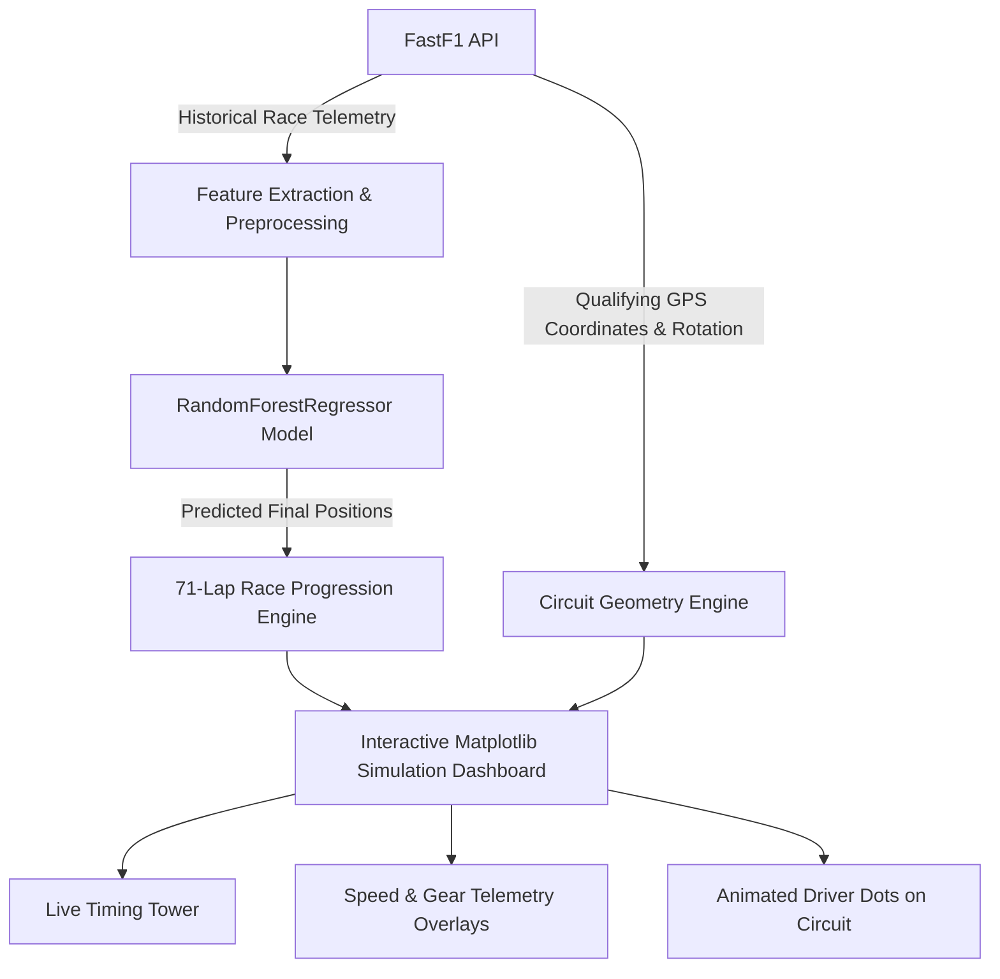

# 🏎️ F1 2026 Mexico City GP — AI Race Prediction & Live Simulator

<p align="center">
  
  
  
  
</p>

An end-to-end Machine Learning and interactive visualization system that predicts Formula 1 Grand Prix race outcomes and renders a **live animated broadcast-style race simulation** of drivers navigating the real **Autódromo Hermanos Rodríguez** circuit.

---

## 🌟 Key Features

- **🤖 Machine Learning Prediction Engine**:
  - Trained on historical official 2026 Grand Prix session telemetry from **FastF1**.
  - Powered by a `RandomForestRegressor` ensemble to predict final race positions based on grid dynamics.
  
- **🗺️ Real GPS Circuit Map (Autódromo Hermanos Rodríguez)**:
  - High-precision telemetry coordinates extracted directly from official qualifying laps.
  - Aligned and rotated with track rotation matrices.
  - Visualizes all **17 numbered turns**, **3 color-coded sectors** (Sector 1 Red, Sector 2 Cyan, Sector 3 Yellow), and **DRS activation zones**.

- **🏁 Interactive Animated Race Simulation**:
  - **22 official 2026 drivers** rendered as team-colored tracking dots with dynamic identification badges.
  - 71-lap realistic race simulation featuring natural overtakes, pace deltas, and strategic shuffling towards predicted finishes.

- **📊 Live Broadcast Timing Tower**:
  - Live lap counter and dynamic race progress bar.
  - Real-time interval delta tracking (`+X.Xs` to leader) with official team livery accent bars.

- **🎮 Real-Time Interactive Controls**:
  - **Speed Multipliers**: Seamlessly switch playback between `1×`, `2×`, and `5×`.
  - **Playback Control**: Pause and resume race playback on demand.
  - **Telemetry Overlay (`📊 Telemetry`)**: Displays live driver **Speed Trace** and discrete **Gear Map (Gears 1–8)** with synchronized track position trackers.
  - **Speed Heatmap (`🗺️ Speed Map`)**: Overlays a colored velocity gradient (`RdYlGn`) directly on the circuit geometry.

---

## 📐 System Architecture



---

## 🛠️ Tech Stack

- **Python 3.10+**
- **[FastF1](https://github.com/theOehrly/Fast-F1)**: Official Formula 1 timing & telemetry data pipeline
- **Scikit-Learn**: Machine Learning model (`RandomForestRegressor`)
- **Matplotlib**: Real-time animation framework & interactive GUI widgets
- **NumPy & Pandas**: High-performance telemetry array manipulation
- **SciPy**: Spline interpolation & track curve smoothing

---

## 🚀 Quickstart Guide

### 1. Clone the Repository
```bash
git clone https://github.com/<your-username>/<your-repo-name>.git
cd <your-repo-name>
```

### 2. Create and Activate Virtual Environment
```bash
# Windows
python -m venv .venv
.\.venv\Scripts\activate

# macOS / Linux
python3 -m venv .venv
source .venv/bin/activate
```

### 3. Install Dependencies
```bash
pip install -r requirements.txt
```

### 4. Run the Prediction & Simulation
```bash
python prediction-model.py
```

> **Note**: On the first execution, FastF1 automatically fetches and caches official timing data in `cache_folder/`. Subsequent runs will load almost instantaneously from local cache.

---

## 🎮 Dashboard Controls

| Button | Action | Description |
| :---: | :---: | :--- |
| `1×` | Normal Speed | Standard simulation cadence (~60 FPS) |
| `2×` | 2× Speed | Double playback speed for rapid race overview |
| `5×` | 5× Speed | Fast-forward to final laps and podium |
| `⏸ Pause` / `▶ Play` | Toggle Playback | Freeze simulation at any lap to inspect standings |
| `📊 Telemetry` | Toggle Telemetry | Show/hide Speed Trace and Gear Map panels |
| `🗺️ Speed Map` | Toggle Heatmap | Switch between sector view and velocity gradient map |

---

## 📄 License

This project is licensed under the [MIT License](LICENSE).
